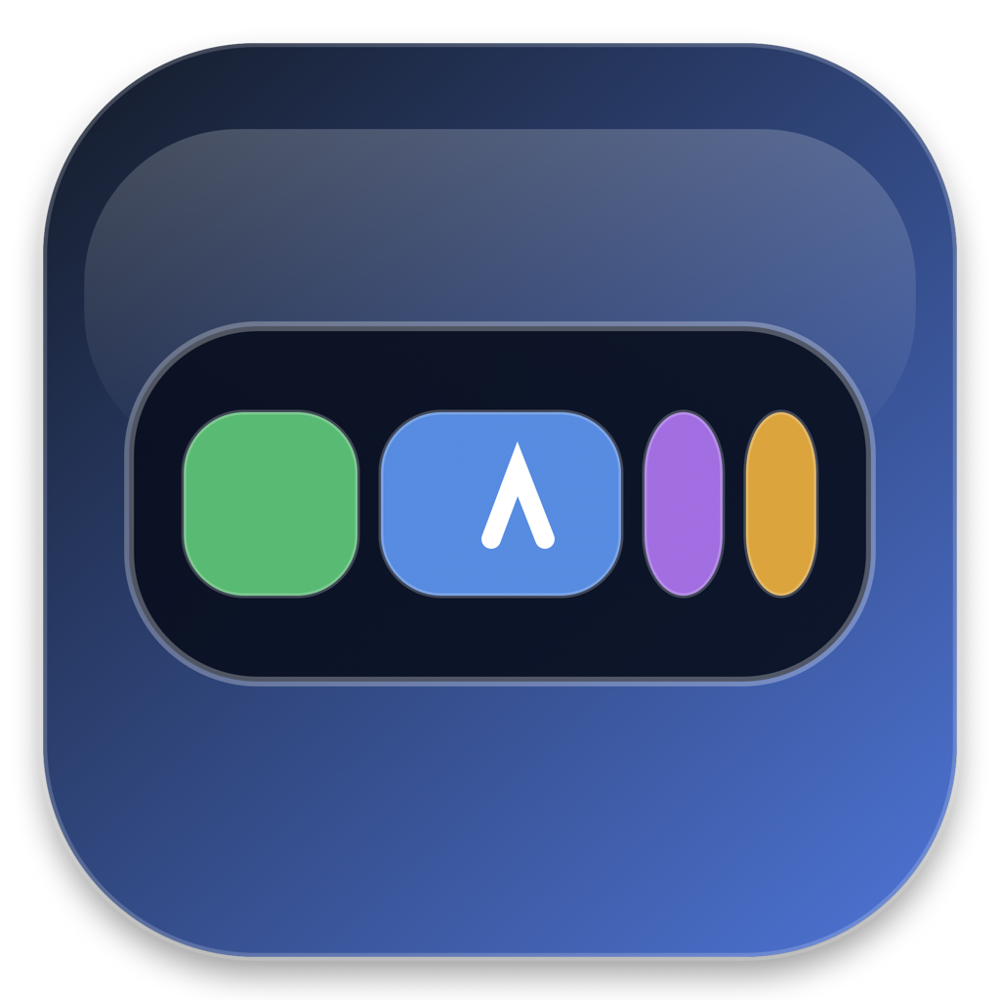
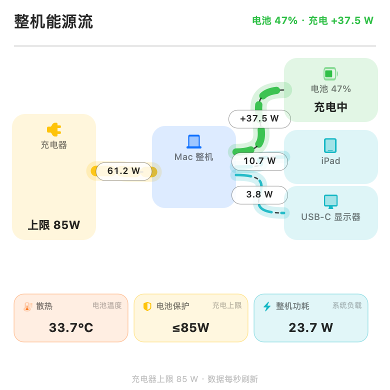
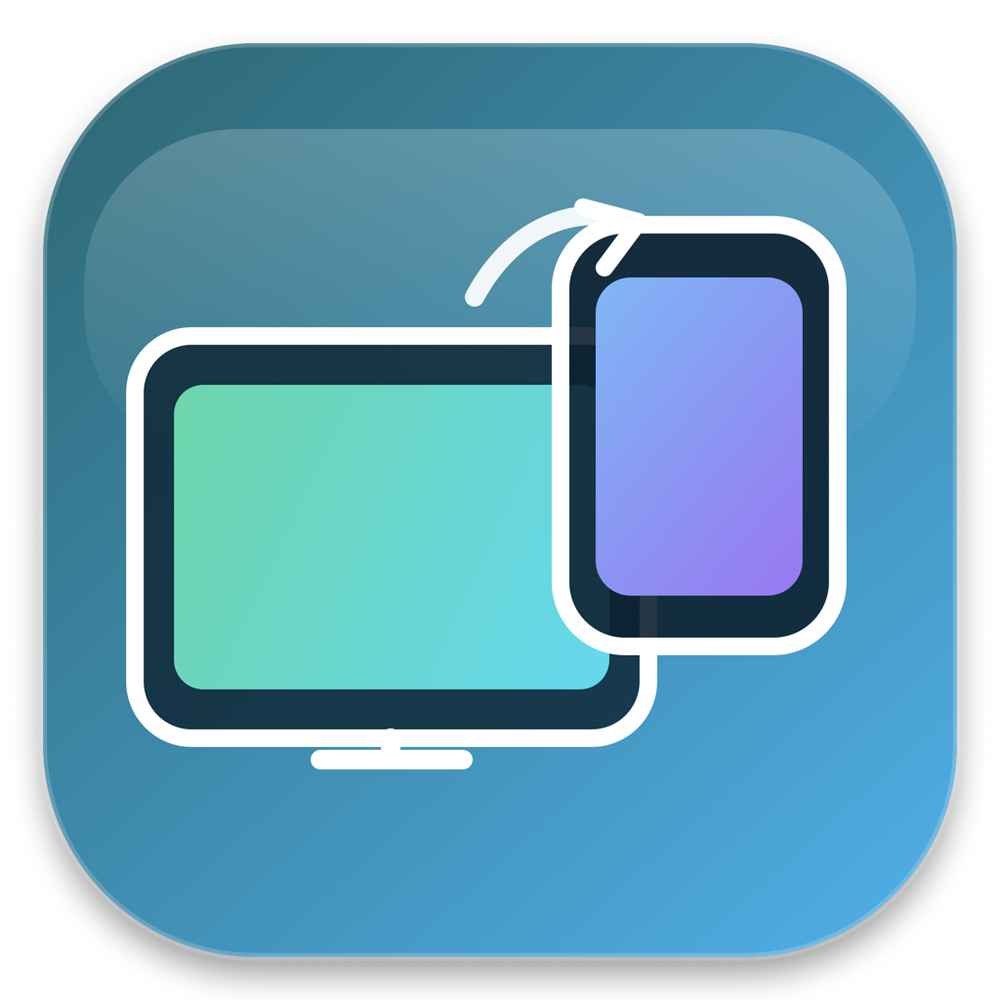

<p align="center">
  
</p>

<h1 align="center">Bar Control</h1>

<p align="center">让 MacBook Pro 的 Touch Bar 重新成为 AI、随航与整机状态控制台。</p>

<p align="center"><a href="https://github.com/cth123456/bar-control/releases/latest">下载最新版</a> · <a href="Apps/BarControl/README.md">Bar Control 完整功能与模块说明</a> · <a href="Apps/SidecarPilot/README.md">随航管家说明</a></p>

<p align="center">
  
  
  
</p>


Bar Control 是一套原生 macOS Touch Bar 工具。主 App 不依赖 BetterTouchTool；随航管家作为可选伴侣 App，没安装时不会占用额外资源。

## 一条 Touch Bar，四个入口

- **随航 ⇄ 通用控制**：连接、断开和失败阶段有颜色及展开动画。
- **AI coding**：显示 Codex 额度、正在运行的任务和最新回复。
- **整机监控**：RunCat 风格动图随实时功率改变速度，点按查看功率、内存、GPU、温度和 USB-C 输入输出。

<p align="center">
  
</p>

## 实时能源流

菜单栏面板按真实方向展示充电器、Mac、电池和外接设备之间的功率；流线粗细随功率缩放，功率越大线条越宽，具体设备用图标表示，功率数值直接标在流线中间。底部用三张状态卡展示散热、电池保护阈值与整机功耗，图上已有数值不会在下方重复。没有外接输出时不会保留空节点；数值每秒更新，虚线速度与方向跟随当前功率。

<p align="center">
  
</p>

## 软件与独立模块

| App | 图标 | 用途 | 必需性 |
| --- | :---: | --- | --- |
| **Bar Control** |  | Touch Bar 主界面、AI coding、能源流、电源策略和系统监控 | 必需 |
| **随航管家** |  | 独立菜单栏 App，一键连接或断开 iPad 随航 | 可选；可单独安装 |
| **优先放电辅助组件** | 命令行 helper | 在支持的 Mac 上通过特权组件断开充电器 | 可选；仅此高级功能需要管理员授权 |

Bar Control 内的随航、AI coding、能源流、供电策略、系统监控、亮度和菜单栏工具都是同一个主 App 中的功能模块，不需要分别下载。只有随航管家和优先放电辅助组件是独立可选项。

## 下载与安装

需要带实体 Touch Bar 的 MacBook Pro、macOS 13 或更高版本。打开[最新版 Release](https://github.com/cth123456/bar-control/releases/latest)，下载 `BarControl-版本号.zip`，解压后将 `Bar Control.app` 移到“应用程序”文件夹并打开。常规使用不需要安装 Xcode、BetterTouchTool 或管理员组件。

如需从源码安装：

源码构建需要完整 Xcode。构建脚本会用系统原生 `actool` 生成 App 图标资源；如果 `xcode-select` 当前指向 Command Line Tools，会自动查找本机已安装的 Xcode。

```sh
git clone https://github.com/cth123456/bar-control.git
cd bar-control
./Apps/BarControl/install.command
```

安装后，Bar Control 会注册为 macOS 登录项。菜单栏和 Touch Bar 的 Control Strip 都能重新唤出主界面。

### 随航管家

随航管家可以独立于主 App 下载和运行，不需要 BetterDisplay。它调用 macOS 内置随航接口；Mac 与 iPad 需满足 Apple 随航兼容条件并使用同一 Apple 账户。源码安装方式：

```sh
defaults write local.codex.SidecarPilot TargetDevice "我的 iPad"
./Apps/SidecarPilot/install.command
```

源码构建会在 `Apps/SidecarPilot/dist/随航管家.app` 生成独立 App。随航管家不会替代 Bar Control 的 Touch Bar 主模块；不需要随航功能时无需安装。

### 优先放电辅助组件

能源流面板、优先充电和负载均衡无需额外下载。选择“优先放电”时，主 App 会提示是否安装可选 helper；只有确认安装时 macOS 才会请求管理员授权。也可在源码目录运行 `Apps/BarControl/install-power-helper.command`。该组件仅用于支持的机型尝试断开充电器；系统或固件拒绝时会退回安全的充电上限策略。卸载命令为 `Apps/BarControl/uninstall-power-helper.command`。

## 自定义

从菜单栏选择“更多操作 → 自定义 Touch Bar 组件…”，可以调整模块显示、宽度和顺序；“Touch Bar 动图”可切换猫、狗、咖啡、水滴、引擎、麻薯、牛顿摆和史莱姆。完整模块列表、兼容性、隐私和功能细节见 [Bar Control 说明](Apps/BarControl/README.md)。

## 构建

```sh
./build-all.command
```

默认生成仅供本机运行的临时签名 App。需要开发者签名时：

```sh
SIGN_IDENTITY="Apple Development: ..." ./build-all.command
```

安装脚本会在覆盖 App 后主动刷新 LaunchServices 登记，避免启动台继续使用旧版本图标。

## 隐私与兼容性

- Bar Control 只读本机 Codex 与 CC Switch 状态，不读取或上传供应商密钥。
- AI coding 与账户用量读取本机客户端状态；Bar Control 不会把供应商密钥上传到项目服务器。
- Touch Bar 全局入口和亮度控制使用 macOS 私有接口，未来系统版本可能需要适配。
- USB-C 端口功率取决于设备是否向 IOKit 发布遥测，无法上报的设备不会伪造数值。

## 开源许可

项目源码使用 [MIT License](LICENSE)。RunCat Neo 动画帧保持原有 Apache License 2.0；详情见 [第三方声明](THIRD_PARTY_NOTICES.md)。
